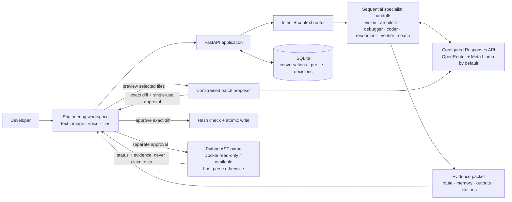

# System architecture

## Request path

1. The router classifies intent and adds context signals for images, selected source files, active project memory, and security/review language.
2. SQLite retrieves matching active decisions. Old free-form records migrate in place and remain available.
3. Role prompts hand the last specialists' notes forward. The final coach follows the effective comfort level and includes relevant memory. Research search is called only for research and security-review routes.
4. The API returns the actual route, per-role outputs, model mode, citation links (when supplied by the provider), and an explicit `not_run` verification state.

## Action boundaries

- A model response never writes files. Patch drafting reads only the selected, supported files and asks before transmitting them to the model provider. The user reviews the complete diff and separately approves the exact patch.
- Application checks do not execute project code. Docker, when installed, parses Python files in a network-disabled read-only container. Otherwise Python's AST parser runs locally without importing or executing the files.
- The OpenRouter key stays in ignored `backend/.env`. Requests are external and can incur provider usage charges. The app sends `store: false`, but provider handling policies still apply.
- The local MVP has no authentication or multi-user isolation; keep it bound to localhost unless protected by a separate access-control layer.
